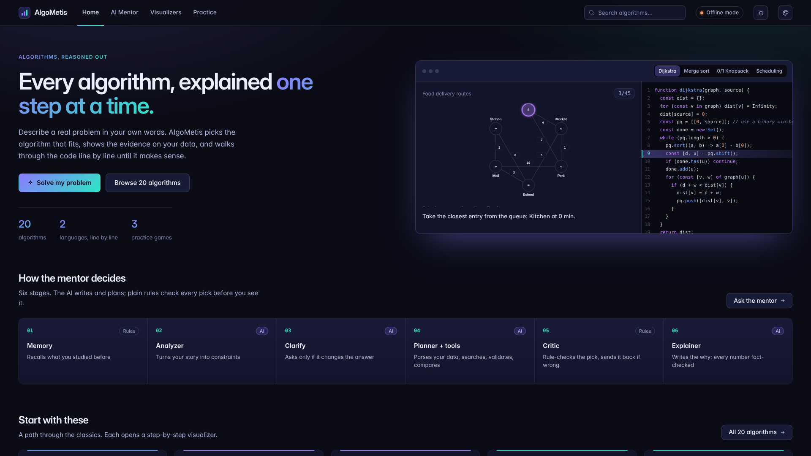
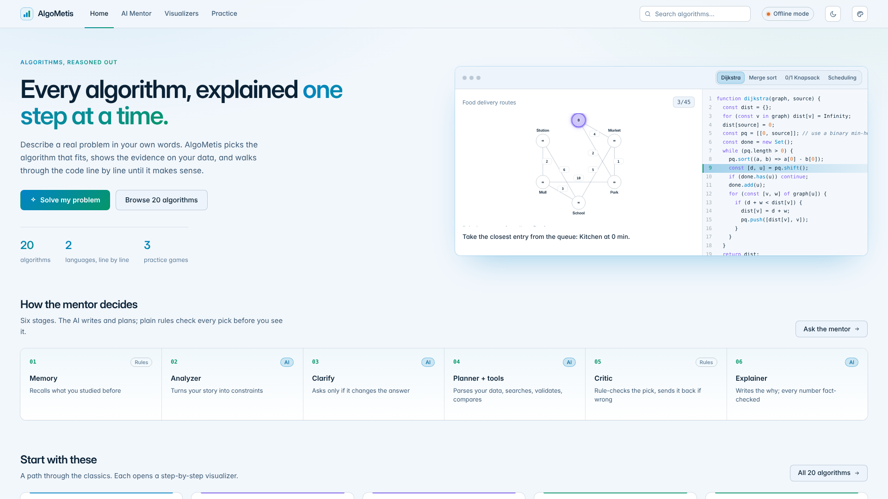
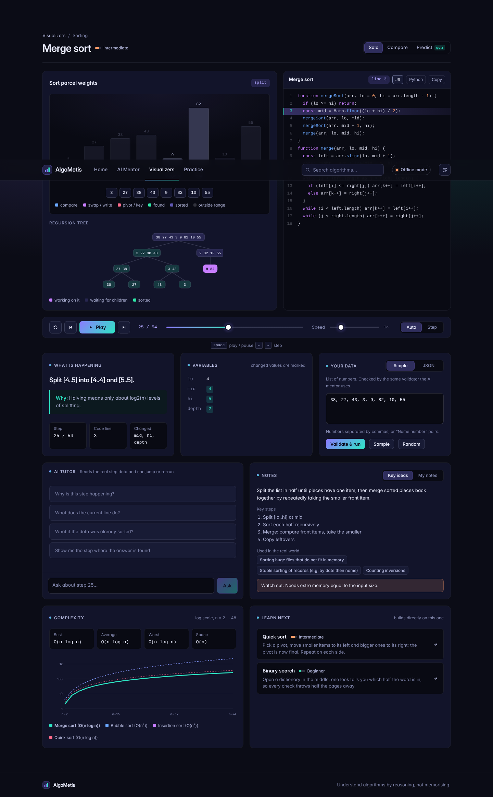
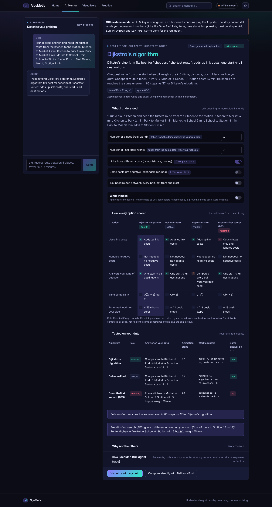
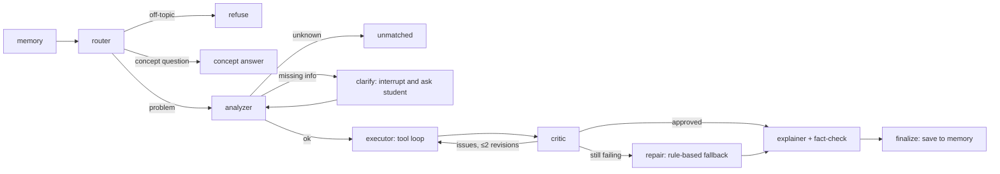
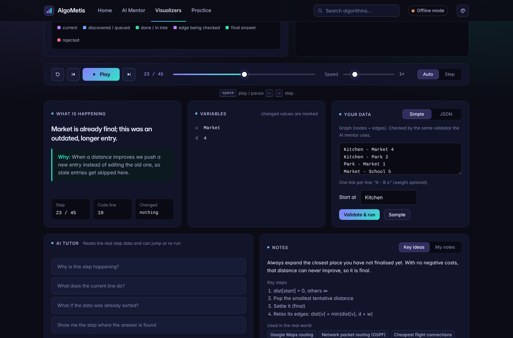
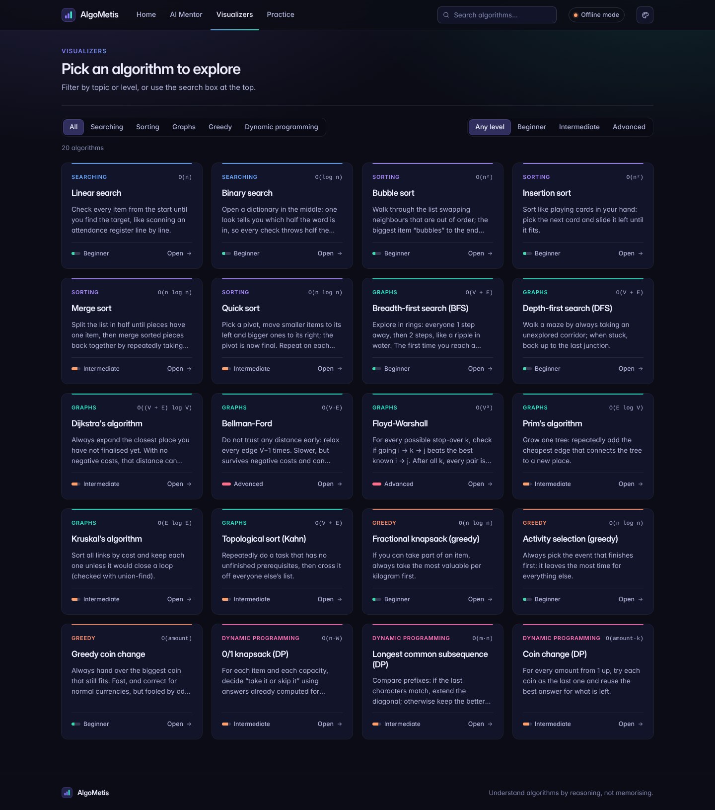

# AlgoMetis: an agentic algorithm tutor

Describe a real-world problem in plain words, with your own names and numbers. AlgoMetis's agent works out which DSA/DAA algorithm fits best, **shows you why** (rules, measurements on your own data, and the full decision trace), and then animates the algorithm **line by line** on that data. You can also skip the agent and explore any of the 20 visualizers, or practise with three learning games.




### What's new in v7

| Area | Change |
|---|---|
| **Light mode** | Every colour scheme now has a light version. Switch with the sun/moon button in the top bar or under Mode in the palette menu; the choice is remembered. |
| **Full-width layout** | The header, pages and footer use the whole screen width with the same edge padding (16–44 px depending on screen size), so the header lines up exactly with the content. Very wide screens get 5 algorithm cards per row. |
| **Spacing check** | Edges, overflow and unwanted scrolling were measured on 11 pages at 1920, 1536, 1280 and 390 px wide, in dark and light. Fixed: the page jumping down on load (the tutor chat scrolled the whole window), the game layout on phones, and the misaligned tutor header. |

### Earlier (v6)

| Area | Change |
|---|---|
| **New name** | The project is now **AlgoMetis** (Metis: the Greek titan of wisdom and good counsel). New logo: three ascending bars. |
| **Dark, colourful design** | Deep tinted surfaces with a two-colour gradient accent (buttons, headline, progress, logo), a colour per topic on the algorithm cards, glowing step colours on the stage, and coloured difficulty bars. No yellow. |
| **Appearance picker** | Palette button in the top bar. 4 colour schemes: *Aurora* (default, violet → teal), *Ocean* (sky blue → mint), *Forest* (emerald → sky), *Ember* (coral → orchid). 3 typefaces: *Clean* (Inter Tight + Inter), *Friendly* (Poppins + Inter), *Editorial* (Lora + Inter). Code is always JetBrains Mono. The choice is remembered. |
| **Symmetric layout** | One spacing scale and one card style everywhere. The visualizer is laid out in even rows: stage + code side by side, a full-width control bar, then 3 equal cards (what is happening · variables · your data), then 2 + 2 (tutor · notes, complexity · learn next). Every page has the same header (breadcrumb, title, subtitle). |
| **Algorithm grid** | One 4-column grid of equal cards with topic and level filters (20 algorithms = 5 even rows). |
| **Own code** | The step player was rewritten as a reducer (`src/visualizer/useStepPlayback.js`). No third-party project code or references remain. |

---

## 1. Quick start

Requirements: **Node.js 20+** (no database, no other services).

```bash
npm install          # React + esbuild only; the server has zero dependencies
npm run build        # bundles the frontend into dist/
npm start            # → http://localhost:8787
```

With no API key it runs in **offline demo mode**: a rule-based stand-in plays the AI parts so you can click through everything. To switch on the real agent:

```bash
cp .env.example .env
# edit .env, for example:
#   LLM_PROVIDER=gemini
#   LLM_API_KEY=your-key       (free key from https://aistudio.google.com)
npm start
```

| `LLM_PROVIDER` | Default model (change with `LLM_MODEL`) | Key needed |
|---|---|---|
| `gemini` | `gemini-2.5-flash` | yes (free tier available) |
| `groq` | `llama-3.3-70b-versatile` | yes (free tier available) |
| `openai` | `gpt-4o-mini` | yes |
| `anthropic` | `claude-sonnet-5-5` | yes |
| `openrouter` | `meta-llama/llama-3.3-70b-instruct` | yes |
| `ollama` | `qwen2.5:7b` (local; needs a tool-calling model) | no |
| `mock` | offline demo | no |

Model names change over time. If a default model has been retired, set `LLM_MODEL` to a current one from the provider's docs. Any OpenAI-compatible endpoint works through `LLM_BASE_URL`.

Development mode (rebuilds on save and restarts the server): `npm run dev`. Run the tests with `npm test`.

**Troubleshooting**
- *Blank page or old design after updating*: stop the server, run `npm install` and `npm run build` again, then hard-reload the browser (Ctrl+Shift+R).
- *A red "This page hit an error" box*: click **Copy details** and share the text. It names the exact component that failed.
- *Port in use*: `set PORT=3000 && npm start` (Windows) or `PORT=3000 npm start`.

---

## 2. What the student can do

| Mode | What happens |
|---|---|
| **Solve my problem** | Chat with the agent. It may ask 1–2 clarifying questions, then returns a recommendation card with: the algorithm and *why*; **What I understood** (editable constraints, recalculated instantly by rules); **How every option scored** (a pass/fail/warn matrix); **Tested on your data** (real runs of the best option, its best alternative, and a rejected one); **Why not the others**; **How I decided** (every LLM thought, tool call, result and check). |
| **Visualize** | Code panel (JavaScript / Python) with the current line highlighted, the data structure animating, the variables (changed ones highlighted), a message and a **why** for every step, playback controls, and a data editor validated by the same rules the agent uses. |
| **Ask the tutor** | A second agent inside the visualizer. It reads the real step data, can **jump** the visualizer to a step, and can **re-run** the algorithm on "what if" data. |
| **Compare** | Two algorithms on the same data, stepping in lockstep, so you can see one finish in 45 steps and the other need 97. |
| **What-if mode** | Ignore what the data proves and toggle hypotheticals ("what if some costs were negative?") to watch the recommendation change. No AI is involved, so the result is instant and deterministic. |
| **Visualizers** | 20 algorithms with difficulty filters, search, and domain-flavoured sample data. |
| **Practice** | Predict the next step · Guess the algorithm · Which algorithm fits? |




Algorithms (DSA/DAA only): linear and binary search · bubble, insertion, merge and quick sort · BFS, DFS, Dijkstra, Bellman-Ford, Floyd-Warshall, Prim, Kruskal, topological sort (Kahn) · fractional knapsack, activity selection, greedy coin change · 0/1 knapsack, LCS and coin change (DP).

---

## 3. Architecture

```
┌────────────────────────── Browser (React) ──────────────────────────┐
│ Solve page ── RecommendationCard (constraints · matrix · evidence · trace)
│ Learn page ── Visualizer (views · CodePanel · variables · playback)   │
│               TutorPanel · InputEditor · ComparePage                  │
│  imports shared/ directly → step generators run in the browser        │
└───────────────┬───────────────────────────────────────────────────────┘
                │ JSON over HTTP (/api/agent/solve, /api/agent/tutor, /api/rescore …)
┌───────────────▼────────────── Node server (no deps) ─────────────────┐
│ server/agent/solveGraph.js   the Solve agent as a state graph         │
│ server/agent/tutor.js        the Tutor agent (tool loop)              │
│ server/agent/toolLoop.js     think → act → observe loop               │
│ server/agent/tools.js        tools the LLM may call                   │
│ server/agent/explain.js      fact pack + claim checker                │
│ server/agent/graphEngine.js  StateGraph · checkpointer · interrupt()  │
│ server/llm/*                 provider adapters + offline mock         │
│ server/memory/store.js       long-term student profiles (JSON file)   │
└───────────────┬───────────────────────────────────────────────────────┘
                │ same code on both sides
┌───────────────▼────────────── shared/ (deterministic) ────────────────┐
│ algorithms/*  step generators (JS + Python code with line markers)    │
│ registry.js   the catalog = agent knowledge base                      │
│ schemas.js    input JSON-schemas + validator + facts from data        │
│ scoring.js    rule-based scoring matrix (no AI)                       │
│ evidence.js   run / compare algorithms on real data                   │
└───────────────────────────────────────────────────────────────────────┘
```

### 3.1 The Solve agent (a graph of stages)



| Stage | Uses the LLM? | What it does |
|---|---|---|
| `memory` | no | Calls `get_student_profile` (algorithms studied, past recommendations, topics they struggle with). |
| `router` | yes (forced tool `route`) | Classifies the message as problem, concept question or off-topic. Off-topic is refused (guardrail). |
| `analyzer` | yes (forced tool `report_constraints`) | Turns the story into a problem type and constraints. Lists *only* the missing facts that would change the answer. |
| `clarify` | no | `interrupt()` pauses the graph and saves state. The student's reply resumes it. At most 2 rounds. |
| `executor` | yes (free tool loop, up to 12 turns) | Plans with tools: `extract_data_from_story` (deterministic parser) → `search_catalog` (with the data's facts) → `get_input_schema` → builds or fixes the input → `validate_input` (fixes errors itself) → `compare_algorithms` → `submit_recommendation`. |
| `critic` | **no, deterministic** | Re-checks the submission: the algorithm is in the catalog and solves this problem type, the input is valid, the rules don't reject it, and it is the rule-ranked best. If not, it sends the issues back to the executor. |
| `repair` | no | After 2 failed revisions, falls back to the rule-ranked best (with sample data if needed) and says so in the trace. |
| `explainer` | yes (forced tool `write_explanation`) | Writes the "because" and the explanation in the student's own terms from a **fact pack**. **Every number and every O(…) is checked** against the facts. One retry, then a rule-generated explanation. |
| `finalize` | no | Builds the response and saves the recommendation to long-term memory. |

### 3.2 Why this counts as an agent (and not just an API call)

| Agent property | Where it lives |
|---|---|
| Autonomy (loop) | `toolLoop.js`: the LLM chooses the next tool until it submits. Its order is not scripted. |
| Tool use | `tools.js` (7 tools) and `tutor.js` (5 tools) |
| Planning | Executor plan in `prompts.js`, carried out step by step with real tool results |
| Memory | Short-term: graph state + checkpointer per thread. Long-term: `memory/store.js` (studied, recommended, tutor questions → "struggles"). |
| Reflection / self-correction | `critic` node → executor revision; explainer fact-check → rewrite |
| Human in the loop | `clarify` node with `interrupt()` / resume |
| Guardrails | Router scope check, max turns, max revisions, schema validation, size limits, rate limiting, request size cap |
| Transparency | Every step goes into `trace` and appears in the UI under "How I decided" |

### 3.3 Nothing is a black box: the explainability design

1. **The LLM judges only one thing:** reading constraints from the story. These are shown in *What I understood*, and the student can edit them.
2. **The scoring is rules, not opinion** (`shared/scoring.js`). Each problem family has criteria rows. Each cell is pass / fail / warn / info with a written reason. An option is rejected if any row fails. The rest are ranked by an estimated-work formula, doubled per warning. The same constraints always give the same table.
3. **Data beats the story.** Facts measured from the input (sorted? negative weights? connected? coin set canonical?) override what the analyzer assumed, and conflicts are shown. A real-world size from the story is kept, because the demo data is only a small sample.
4. **Proof on your data** (`shared/evidence.js`): the chosen algorithm, the best alternative, and one rejected-but-runnable option really run on the student's data. You see their answers, step counts and work counters, and whether they agree.
5. **The explanation is fact-checked** (`server/agent/explain.js`). If the LLM writes a number or a complexity that isn't in the fact pack, the text is rejected.
6. **Full trace:** every LLM thought, tool call with arguments, tool result and critic check.

### 3.4 The visualizer engine

Each algorithm in `shared/algorithms/` exports `run(input) → { steps, result }` and its code in two languages. The code carries line markers (`//@settle`, `#@settle`) that are stripped at load and turned into a line map, so a step's `line: 'settle'` always highlights the correct line in **both** languages. This is enforced by a test. Each step holds a `message`, a `why`, `vars`, and a `view` snapshot that one of five generic renderers draws: `array`, `graph`, `table` (DP / matrix), `items` (greedy) or `timeline` (scheduling). Because inputs are generic (names, units, titles), the agent can feed any scenario into any visualizer.

---

## 4. Project structure

```
algometis/
├── server/
│   ├── index.js            HTTP API + static files (node:http, zero deps)
│   ├── config.js           .env loader, provider presets
│   ├── agent/              graphEngine, solveGraph, toolLoop, tools, prompts, explain, tutor, trace
│   ├── llm/                providers.js (OpenAI-compatible, Anthropic), mock.js (offline), index.js
│   └── memory/store.js     student profiles (data/profiles.json)
├── shared/                 used by BOTH server and browser
│   ├── algorithms/         searching, sorting, graphs, greedy, dp (+ index)
│   ├── registry.js         catalog: complexity, when to use, pitfalls, related notes, samples
│   ├── schemas.js          input schemas, validator, facts derived from data
│   ├── scoring.js          problem families, criteria, ranking
│   ├── evidence.js         run / compare / evidence
│   ├── storyParser.js      reads names/numbers/links/items/times from plain text
│   └── learning.js         difficulty, full complexity table, growth curves, notes, next topics
├── src/
│   ├── pages/              Home (hero + explore), AI Mentor, Visualize (Solo/Compare/Predict), Practice
│   ├── visualizer/         views (bars, graph, DP table, items, timeline, recursion tree), panels, code panel, input, tutor
│   ├── practice/           Predict, Guess the algorithm, Which fits, stats
│   └── components/         navbar + search, recommendation card, trace, UI kit
├── tests/                  node:test suites (33 tests)
├── scripts/                build.mjs (esbuild), dev.mjs
└── docs/screenshots/
```

### API

| Method & path | Purpose |
|---|---|
| `GET /api/health` | Provider and model in use; whether offline demo is on |
| `GET /api/catalog` | Algorithms, families (constraint fields), input kinds |
| `POST /api/agent/solve` `{threadId, studentId, message}` | Runs or resumes the Solve agent → `clarify` · `done` · `refused` · `answer` · `unmatched` (+ trace) |
| `POST /api/rescore` `{problemType, constraints, input, whatIf}` | Deterministic re-scoring + evidence (no AI) |
| `POST /api/agent/tutor` `{algoId, input, stepIndex, question, history}` | Tutor agent → `{answer, actions, trace}` |
| `GET /api/profile/:id`, `POST /api/profile/:id/studied` | Long-term memory |

---

## 5. Adding an algorithm

1. Write a step generator in `shared/algorithms/<family>.js`: `run(input)` plus `code: sources(js, py)` with `//@key` / `#@key` markers. Every `R.add(key, message, why, vars, view)` must use a key that exists in both languages.
2. Register it in `shared/registry.js`: name, category, `families`, `inputKind`, `rules`, `complexity`, `cost(c)`, `whenToUse`, `pitfalls`, `sample`, and optional `related` notes.
3. Add it to a family's `candidates` in `shared/scoring.js`, plus a criterion row if it introduces a new trade-off.
4. Run `npm test`. The registry test checks the sample, the steps and the line maps automatically.

---

## 6. Tests (`npm test`)

32 tests with Node's built-in runner:

- **Algorithms:** correctness against brute-force references (random graphs for Dijkstra / Bellman-Ford / Floyd-Warshall, brute-force knapsack, sort stability, Prim = Kruskal totals, topological order validity, negative-cycle detection). Every step's line key exists in JS and Python.
- **Story parser:** graph links (weighted, "between…and", friends, prerequisites with "and"), lists, labelled scores, items, time slots, strings, coins; never invents missing data; the simple-input box round-trips; the offline agent uses the student's own data end to end.
- **Animations:** sorting views keep stable ids (always a permutation that follows its values); merge-sort recursion tree is complete and sorted at the end.
- **Scoring:** expected winners for each family; data facts override the story; no mixing of real-world sizes with demo sizes.
- **Agent:** graph engine (reducers, conditional edges, interrupt/resume); a full Solve run with tool calls and trace; the clarify → resume flow; off-topic refusal and concept answers; the critic rejecting a wrong pick and the executor revising; the fact-checker rejecting an invented number; tutor jump and re-run; a **full agent run through the OpenAI wire format** against a simulated HTTP server; Anthropic message grouping; an HTTP API smoke test.

---

## 7. Honest notes and limitations (v1)

- **The graph engine is not LangGraph.** The build environment could not install npm packages, so `graphEngine.js` implements the same concepts (StateGraph, reducers, conditional edges, checkpointer, `interrupt` / `Command({resume})`) in about 170 readable lines. Each node is a plain `async (state, ctx) => update` function, so porting to `@langchain/langgraph` is mostly mechanical. That's a good v2 task if your guide wants the library itself.
- **Real LLM providers were tested against simulated HTTP responses, not live APIs** (no keys or internet in the build environment). The adapters follow the documented OpenAI-compatible and Anthropic Messages formats. A wire-format end-to-end test covers the whole agent. Try your provider and check the trace if something looks off.
- **Offline demo mode is not AI.** The router, analyzer and explainer are keyword and template stand-ins. The story parser is deterministic and reads data written in common patterns ("A to B 4", "X before Y", "laptop 5 kg value 10", "Quiz 9-10"). Free-form wording still needs a real LLM. When the story has no usable numbers, it falls back to clearly-labelled example data.
- **"Estimated work" numbers are cost-model estimates** for ranking (e.g. (V+E)·log V), not measured runtimes. Measured step counts are in "Tested on your data".
- Memory is a JSON file with an anonymous browser id (no login). The data limits (≤ 10 nodes, ≤ 16 items, capacity ≤ 30 …) keep animations readable.
- Out of scope by design: OS / OOP topics; weighted interval scheduling (flagged when relevant).

### Ideas for v2

Port to LangGraph · streaming progress per graph node · guided first-visit tour · login and saved sessions · more algorithms (A*, segment tree, edit distance, matrix chain) · quiz mode generated from the steps · an LLM-assisted critic for scenario-to-input faithfulness · teacher dashboard built on the memory store.

---

## Fonts

Inter, Inter Tight, Poppins, Lora and JetBrains Mono are loaded from Google Fonts (all SIL Open Font License). Without internet the app falls back to system fonts.



