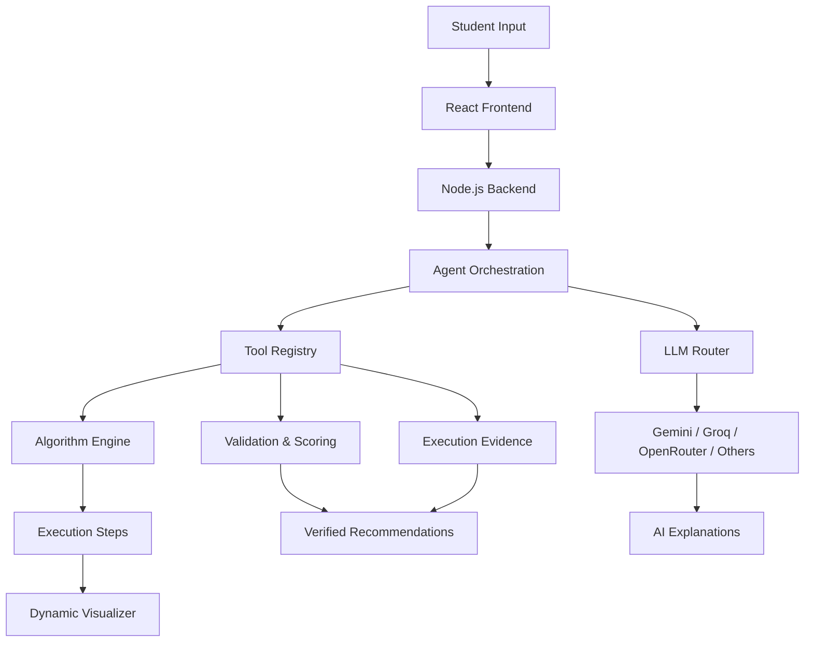
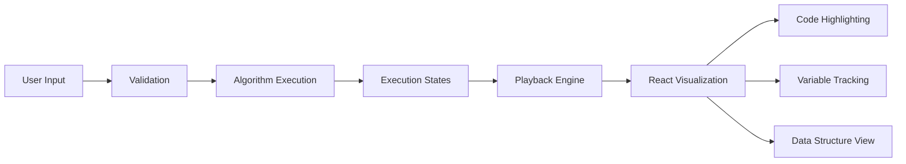
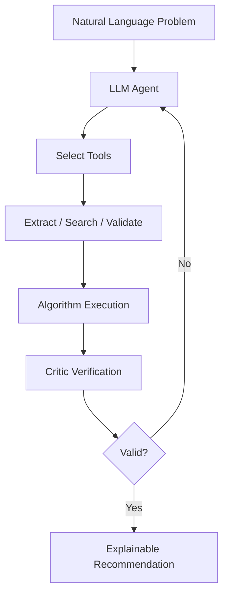

<div align="center">

#  AlgoMetis

### Think Algorithms. See Them Work. Understand Why.

**An Agentic AI-Powered Platform for Intelligent Algorithm Learning**

Transform real-world problems into algorithmic solutions through AI reasoning, explainable recommendations and interactive visualizations.

<br/>

[]()
[]()
[]()
[]()

<br/>

[Overview](#overview) · [Features](#features) · [Architecture](#architecture) · [Tech Stack](#tech-stack) · [Setup](#getting-started)

<br/>


</div>

---

## Overview

AlgoMetis bridges the gap between understanding algorithms and applying them to real-world problems.

Instead of manually searching for solutions, students can describe problems in natural language, receive intelligent algorithm recommendations, inspect the reasoning behind them and visualize their execution using custom inputs.

**One platform. From problem understanding to algorithm execution.**

## Features

| | Feature | Description |
|:---:|---|---|
| 🤖 | **AI Problem Solver** | Converts natural-language problems into algorithmic solutions. |
| 📊 | **Dynamic Visualizer** | Executes algorithms step by step with synchronized code and variable tracking. |
| 🧑‍🏫 | **AI Mentor** | Provides contextual explanations and interactive learning assistance. |
| ⚖️ | **Algorithm Comparison** | Compares algorithm behavior, operations and complexity. |
| 🔍 | **Explainable Recommendations** | Uses deterministic scoring, execution evidence and verification. |
| 💻 | **C Code Review** | Analyses C programs using static analysis and complexity heuristics. |
| 🎮 | **Practice Arena** | Interactive challenges to strengthen algorithmic thinking. |
| 🧠 | **Student Memory** | Maintains learning context for personalized interactions. |

## Preview

<div align="center">

<table>
<tr>
<td align="center">

<br/><b>Algorithm Visualizer</b>
</td>
<td align="center">

<br/><b>AI Mentor</b>
</td>
</tr>
<tr>
<td align="center">

<br/><b>Graph Algorithms</b>
</td>
<td align="center">

<br/><b>Explore Algorithms</b>
</td>
</tr>
</table>

</div>

## Architecture

AlgoMetis combines two complementary approaches:

- **Deterministic computation:** Handles algorithm execution, validation, scoring and visualization.
- **LLM-powered reasoning:** Handles natural-language understanding, recommendations, tool selection and explanations.



### Dynamic Visualization

The visualizer does not depend on AI-generated animations. Each algorithm executes through a deterministic step generator, producing structured execution states that React renders interactively.



### Agentic AI Workflow

The AI agent dynamically selects backend tools, observes their results and continues reasoning until it produces a validated recommendation.



## Algorithm Library

**20 algorithms across five categories.**

| Category | Algorithms |
|---|---|
| Searching | Linear Search, Binary Search |
| Sorting | Bubble, Insertion, Merge, Quick |
| Graphs | BFS, DFS, Dijkstra, Bellman-Ford, Floyd-Warshall, Prim's, Kruskal's, Topological Sort |
| Greedy | Fractional Knapsack, Activity Selection, Greedy Coin Change |
| Dynamic Programming | 0/1 Knapsack, LCS, Coin Change |

## AI Infrastructure

AlgoMetis uses a modular LLM provider architecture.

| Provider | Integration |
|---|---|
| Google Gemini | API |
| Groq | API |
| OpenRouter | API |
| Cerebras | API |
| Mistral | API |
| OpenAI / Anthropic | Optional API integrations |
| Ollama | Optional local inference |

Provider routing supports configurable selection, failover and offline rule-based fallback.

**Ollama is optional.** The algorithm execution and visualization engines work independently of LLM providers.

## Tech Stack

<div align="center">

| Layer | Technologies |
|---|---|
| Frontend | React, CSS, JavaScript |
| Backend | Node.js, HTTP APIs |
| AI | Gemini, Groq, OpenRouter, Ollama |
| Agent Framework | Custom tool-calling architecture |
| Algorithm Engine | JavaScript |
| Data Exchange | JSON |
| Persistence | JSON files, LocalStorage |
| Build | esbuild |
| Testing | Node.js Test Runner |

</div>

## Project Structure

```text
algometis/
├── server/
│   ├── agent/          # Agent orchestration and tools
│   ├── llm/            # Provider adapters and routing
│   ├── memory/         # Student memory
│   └── index.js        # Backend server
│
├── shared/
│   ├── algorithms/     # Algorithm implementations
│   ├── registry.js     # Algorithm registry
│   ├── schemas.js      # Input validation
│   ├── scoring.js      # Recommendation scoring
│   └── evidence.js     # Execution evidence
│
├── src/
│   ├── components/     # Reusable UI components
│   ├── pages/          # Application pages
│   ├── visualizer/     # Visualization engine
│   ├── practice/       # Learning games
│   └── App.jsx
│
├── tests/              # Automated test suites
├── scripts/            # Build and development scripts
├── docs/               # Screenshots and documentation
├── .env.example
└── package.json
```

## Getting Started

### Prerequisites

- Node.js 20+
- npm
- LLM API key (optional)

### Installation

```bash
# Clone repository
git clone https://github.com/YOUR_USERNAME/algometis.git

# Navigate into project
cd algometis

# Install dependencies
npm install

# Configure environment
cp .env.example .env

# Build application
npm run build

# Start server
npm start
```

Open the local URL displayed in the terminal (default: `http://localhost:8787`).

### Development

```bash
npm run dev
```

### Run Tests

```bash
npm test
```

### LLM Configuration

Add the API keys for your preferred providers to `.env`.

```env
GEMINI_API_KEY=your_key
GROQ_API_KEY=your_key
OPENROUTER_API_KEY=your_key
```

Refer to `.env.example` for additional configuration.

Never commit API keys or your `.env` file.

## Engineering Principles

- **Explainability:** Recommendations are supported by deterministic scoring and execution evidence.
- **Reliability:** Core algorithm execution does not depend on external AI services.
- **Modularity:** Independent algorithm, agent, visualization and provider layers.
- **Reproducibility:** Algorithm execution produces structured, deterministic states.
- **Resilience:** Multiple AI providers with configurable fallback.

## Roadmap

- [ ] Expand the algorithm library.
- [ ] Add AST-based C code analysis.
- [ ] Introduce secure sandboxed code execution.
- [ ] Add actual runtime and memory benchmarking.
- [ ] Expand personalized learning analytics.
- [ ] Improve multi-agent verification.
- [ ] Extend interactive visualization capabilities.

---

<div align="center">

### From Understanding to Execution.

**AlgoMetis — Making algorithmic thinking visual, intelligent and interactive.**

<br/>

Built with curiosity, code and a passion for learning.

</div>
